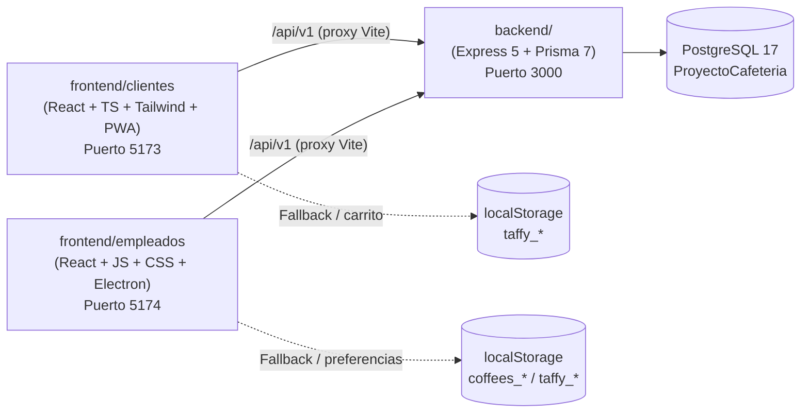

# Arquitectura del frontend

## Base acordada — Monorepositorio dual

De acuerdo con [ADR 0013](../../backend/docs/adr/0013-application-repository-layout.md) y
[FE-ADR 0001](adr/0001-dual-frontend-applications.md), el frontend vive dentro del repositorio
común bajo `frontend/` y se divide en **dos aplicaciones web independientes**, cada una con su
propio `package.json`, herramientas de construcción, estilo visual y estrategia de ejecución:

| Aplicación | Ruta | Puerto dev | Tecnología principal | Público objetivo |
| --- | --- | --- | --- | --- |
| Portal de clientes | `frontend/clientes/` | `5173` | React 19, TypeScript, Vite 8, Tailwind CSS, PWA | Invitados y clientes (`CLIENTE`) |
| Terminal POS / Admin | `frontend/empleados/` | `5174` | React 19, JavaScript (JSX), Vite 8, Vanilla CSS, Electron 44 | Personal (`CAJERO`, `PREPARACION`, `ADMINISTRADOR`, `GERENTE` local) |

Ambas aplicaciones se comunican con la API REST en `http://localhost:3000/api/v1` mediante
solicitudes relativas a `/api/v1` que los servidores de desarrollo Vite reenvían al backend.



---

## Estructura de `frontend/clientes/`

```text
frontend/clientes/
├── public/
│   ├── manifest.json            # Metadatos PWA (Coffee's POS, standalone, iconos)
│   ├── sw.js                    # Service Worker Network-first (excluye /api/)
│   └── logo.png / icon-*.png    # Logotipo e iconos PWA
├── src/
│   ├── api/                     # Clientes HTTP tipados (client, auth, catalog, orders, favorites, registration)
│   ├── components/              # Header, ProductCard, ProductModal, CartDrawer, OrderConfirmationModal,
│   │                            # OrderHistoryModal, ProfileModal, PinInput
│   ├── context/                 # AuthContext, CartContext, ToastContext
│   ├── data/                    # Arreglos base vacíos (products.ts, initialOrders.ts) tras limpieza de demos
│   ├── pages/                   # AuthPage (/iniciar-sesion), MenuPage (/menu)
│   ├── types/                   # Interfaces TypeScript (Product, CartItem, Order, User, CustomizationOptionGroup)
│   ├── utils/                   # money.ts (centavos <-> MXN), categories.ts (mapeo de iconos Material Symbols)
│   ├── App.tsx                  # Proveedores de contexto y React Router DOM
│   └── main.tsx                 # Montaje React 19 y registro del Service Worker
├── index.html                   # Fuentes Plus Jakarta Sans, Material Symbols Outlined y meta tags móviles
├── tailwind.config.js           # Paleta semántica café/crema, radios y escalas tipográficas
└── vite.config.ts               # Proxy /api -> http://localhost:3000 (Origin http://localhost:5173)
```

### Capas internas en `frontend/clientes/`

1. **Capa de transporte (`src/api/`)**: `client.ts` encapsula `fetch` con `credentials: 'include'`, gestión en memoria del token CSRF (`GET /auth/csrf`, reintento en `403 CSRF_INVALID`) y parseo uniforme de errores `application/problem+json` mediante `ApiError`.
2. **Capa de estado global (`src/context/`)**:
   - `AuthContext` mantiene sesión en memoria (`currentUser` consultado vía `GET /customers/me`), modo invitado (`isGuest`, `guestName`), perfil y sincronización optimista de favoritos.
   - `CartContext` administra líneas del carrito en `localStorage` (`taffy_cart`), estado de modales/drawers y envío de órdenes (`submitOrder` → `createMobileOrder`).
   - `ToastContext` administra notificaciones flotantes con auto-cierre a 3.2 s.
3. **Capa de presentación (`src/pages/`, `src/components/`)**: Diseño *mobile-first* centrado en `max-w-md`, modales *bottom-sheet* en móvil y barra inferior fija para abrir el carrito.

---

## Estructura de `frontend/empleados/`

```text
frontend/empleados/
├── electron/
│   └── main.cjs                 # Ventana principal Electron (sandbox, contextIsolation, menú Kiosco)
├── src/
│   ├── api/                     # Clientes HTTP (client, auth, cash, catalog, employees, kitchen, sales)
│   ├── components/              # Pantallas de acceso, espacios de trabajo POS/Admin y modales
│   ├── data/                    # Persistencia local (db.js, employees.js, menuData.js)
│   ├── styles/                  # Sistema de diseño Vanilla CSS + 4 temas + media print
│   ├── utils/                   # audio.js (Web Audio), crypto.js (SHA-256), money.js, notify.js, tenant.js
│   ├── App.jsx                  # Máquina de estados de navegación, carrito POS, cobro y guardas de rol
│   └── main.jsx                 # Montaje React 19
├── respaldo/                    # Copia archivada del modo Restaurante y Salón de Mesas (sin uso activo)
├── js/ & css/ & index.vanilla.html  # Prototipo inicial Vanilla JS conservado en el repositorio
└── vite.config.js               # Proxy /api -> http://localhost:3000 (base './' para Electron)
```

### Capas internas en `frontend/empleados/`

1. **Navegación sin Router (`App.jsx`)**: La terminal usa estado local `activeScreen` (`welcome` → `employee-id` → `employee-pin` → `pos`) y `activePosTab` (`order`, `history`, `shift`, `kitchen`, `admin-dashboard`, `menu-admin`, `users-admin`). Esto facilita la operación como aplicación de escritorio (`file://` en Electron con `base: './'`).
2. **Bus de eventos local (`window.dispatchEvent`)**: `notify.js`, `db.js`, `employees.js` y `menuData.js` utilizan eventos personalizados (`coffees:toast`, `coffees:confirm`, `coffees:menu_updated`, `coffees:employees_updated`, más alias `taffy:*`) para comunicar cambios sin contextos React globales.
3. **Integración híbrida API + respaldo local**: Las vistas consultan primero `/api/v1` y conservan copias en `localStorage` para mantener operativa la UI si el servidor está apagado o una ruta falla. En [persistencia local](storage/local-persistence.md) se detallan los riesgos de esta convivencia.

---

## Fronteras entre Frontend y Backend

- **Precios y totales**: El backend calcula y congela los importes de órdenes, recargos y cambio en efectivo. El frontend solo debe estimar visualmente y formatear centavos. *(Brecha actual: el POS suma un 16% de IVA local que el backend no aplica).*
- **Autorización y sesiones**: El frontend controla visibilidad de pestañas y botones por rol, pero el backend valida sesión, rol en BD, `Origin` y `X-CSRF-Token` en cada solicitud.
- **Impresión y renderizado**: El backend entrega DTOs JSON (`sales/{id}/ticket`, `guest-ticket`, `cashQr`). La generación de códigos QR gráficos y la impresión térmica (`window.print()`) corresponden íntegramente al frontend.
- **Pagos con tarjeta**: El frontend nunca debe recolectar datos de tarjeta (PAN/CVV); debe redirigir a la URL de Stripe Checkout retornada por `POST /orders/{id}/checkout` cuando Stripe esté habilitado.

Referencias: [integración con backend](backend-integration.md), [cobertura de endpoints](api/endpoints-coverage.md), [arquitectura backend](../../backend/docs/architecture.md).
