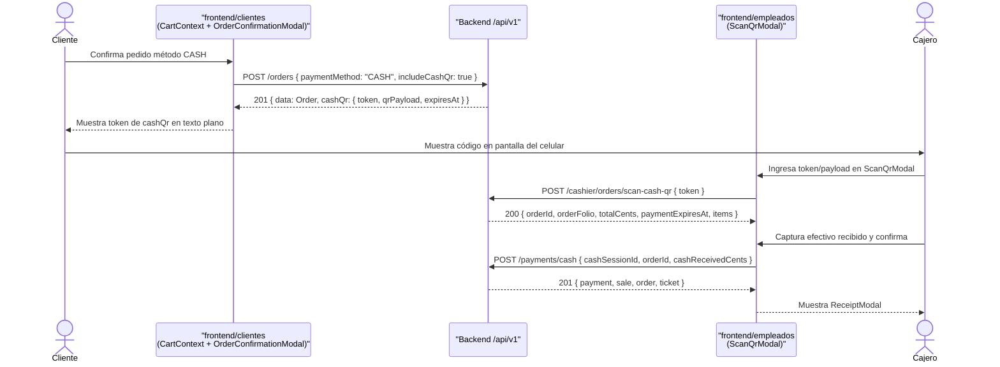

# QR de cobro en efectivo (`CASH-03`)

Documenta el flujo de pago en efectivo originado desde el portal de clientes (`frontend/clientes`)
y cobrado en la terminal de empleados (`frontend/empleados`) usando QR de cobro (`CASH-03`).

## 1. Flujo implementado de extremo a extremo

### En el portal de clientes (`frontend/clientes/`)

- `CartContext.tsx` envía automáticamente `includeCashQr: true` cuando `paymentMethod === 'CASH'`.
- `OrderConfirmationModal.tsx` (líneas 70–88) muestra un bloque `"Pagar en Efectivo en Caja"` desplegando `lastCompletedOrder.cashQr.token` en fuente monoespaciada seleccionable.
- El `token` se mantiene exclusivamente en memoria React (`lastCompletedOrder`) sin persistirse en `localStorage`.

### En la terminal POS (`frontend/empleados/`)

- `OrderingWorkspace.jsx` incluye el botón `"📱 Cobrar QR Móvil"` que abre `ScanQrModal.jsx`.
- `ScanQrModal.jsx`:
  1. Acepta tanto el token limpio como el payload con prefijo (`cafeteria:cash:<token>`), ya que `scanCashPaymentQr()` en `src/api/cash.js` ejecuta `.replace('cafeteria:cash:', '').trim()`.
  2. Invoca `POST /api/v1/cashier/orders/scan-cash-qr`.
  3. Muestra folio, cliente y `totalCents` formateado sin IVA local adicional, calcula el cambio sugerido y permite volver o confirmar el cobro.
  4. Al confirmar, invoca `chargeCashOrder(resolvedOrder.orderId || resolvedOrder.id, numberToCents(receivedNum))` → `POST /api/v1/payments/cash` y abre `ReceiptModal`.

## 2. Qué falta por implementar frente a `CASH-03`

1. **Renderizado gráfico del código QR en `OrderConfirmationModal.tsx`**:
   - La aplicación de clientes no tiene instalada ninguna librería generadora de QR (como `qrcode.react` o `qrcode`). Actualmente muestra solo la cadena cruda `cashQr.token` en texto, obligando al cajero a copiar/pegar o teclear 43 caracteres manualmente.
   - Debe renderizarse `cashQr.qrPayload` (`cafeteria:cash:<token>`) como gráfico QR escaneable, conservando el token en texto como alternativa accesible y mostrando la hora de expiración (`cashQr.expiresAt`, 30 min).
2. **Escaneo por cámara o lector en `ScanQrModal.jsx`**:
   - Actualmente solo cuenta con un `<input type="text">` manual. Falta integrar lectura por cámara web (`BarcodeDetector` / `html5-qrcode`) o foco optimizado para lector de códigos 2D USB/Bluetooth.
3. **Emisión / reimpresión de QR CASH desde caja**:
   - No existe pantalla o acción en el POS que llame a `POST /api/v1/cashier/orders/{id}/cash-qr` para emitir o reimprimir el QR de cobro de una orden `CASH` pendiente de pago.
4. **Recuperación del ticket y registro QR tras cobro en `ScanQrModal.jsx`**:
   - Cuando un invitado paga en caja mediante `ScanQrModal.jsx`, `handleCharge()` arma el objeto de recibo local sin consultar `GET /api/v1/sales/{id}/ticket` (`ticket.path`), por lo que el ticket impreso desde un cobro QR móvil **no incluye el código de registro `AUTH-02`** para el cliente.
5. **Visualización de líneas en el resumen de `ScanQrModal.jsx`**:
   - `POST /cashier/orders/scan-cash-qr` devuelve `items` de la orden, pero `ScanQrModal.jsx` solo muestra folio, nombre de cliente y total sin listar los productos a cobrar para verificación visual del cajero.

Referencias: [CASH-03 backend](../../backend/docs/cash-qr-implementation.md), [tickets e invitado](guest-ticket-implementation.md).
